# MONOWEAR — わざと使いにくい EC サイト

プロダクト思考を学ぶワークショップ用の教材です。
架空のアパレルショップ「MONOWEAR」の通販サイトを、**わざと UI/UX が悪くなるように**作っています。

- 体験用 URL：https://monowear.na2kera.workers.dev
- 対象：エンジニア志望の学生
- 端末：PC のブラウザ（スマホには対応していません）

> このサイトは架空のショップです。注文・決済・メール送信などは一切行われず、入力した内容はブラウザの localStorage にしか保存されません。

## ワークショップの流れ

1. **自由に触る（15〜20分）**：課題は出しません。普通の買い物客のつもりで、商品を探してカートに入れ、購入完了まで進んでみてください。
2. **気づいたことを書き出す**：「イラッとした」「迷った」「損をした気がした」場面を、できるだけ具体的に書き出します。
3. **議論する**：
   - なぜその体験が悪いのか（ユーザーは何をしたくて、何に邪魔されたのか）
   - 作り手は、なぜそう作ってしまったのか（技術・ビジネス・組織の事情）
   - 自分が作るなら、何に気をつけるか

**この README は答え合わせ用です。体験前の参加者には見せないでください。**

---

## 仕込んだ 20 個の「悪さ」

見た目は普通の EC サイトですが、使うとじわじわストレスが溜まる「リアル路線」で作っています。
このうち 4 個は、ユーザーを意図的に誘導したり欺いたりする **ダークパターン** です（【ダーク】と表記）。

コード中の該当箇所には `ANTI-PATTERN #n` というコメントを付けています。`grep -rn "ANTI-PATTERN" src` で一覧できます。

| # | 画面 | 悪さ |
|---|---|---|
| 1 | 共通 | ヘッダーのカート件数が、リロードするまで更新されない |
| 2 | トップ | 開くたびにクーポンのモーダルが出て、閉じる「×」が小さく薄い |
| 3 | トップ | カルーセルが 2.5 秒で自動で切り替わり、止められない |
| 4 | 一覧 | 絞り込みを 1 つ変えると、他の条件がリセットされる |
| 5 | 一覧 | 一覧は税抜、詳細は税込で金額が合わない |
| 6 | 一覧 | 在庫切れの商品が普通に並んでいる |
| 7 | 詳細 | 色を変えると、選んだサイズがリセットされる |
| 8 | 詳細 | サイズ表が別タブで開き、cm とインチが混在している |
| 9 | 詳細 | 「カートに入れる」を押しても何の反応もない |
| 10 | 詳細 | 【ダーク】どの商品にも「残り2点！」 |
| 11 | カート | 数量を変えても「数量を更新」を押さないと反映されない |
| 12 | カート | 「削除」が確認なしで即実行され、「購入手続きへ」より目立つ |
| 13 | カート | 【ダーク】ギフトラッピング（+550円）が最初から追加されている |
| 14 | カート | 送料が購入手続きの最後まで分からない |
| 15 | 会員登録 | 【ダーク】「登録せずに購入」のリンクが極小・最下部 |
| 16 | 会員登録 | パスワードの条件が後出しで、エラーが出ると入力が全部消える |
| 17 | 会員登録 | 【ダーク】メルマガ 3 種が最初からすべて ON で、規約の下に埋もれている |
| 18 | 購入手続き | 全角・半角の指定がバラバラで、電話番号は 3 分割 |
| 19 | 購入手続き | エラーが上部にまとめて出るだけで、どの欄のエラーか分からない |
| 20 | 完了 | 「ありがとうございました」だけで、注文内容も注文番号もない |

以下、1 つずつ解説します。「なぜ悪いか」「自分ならどうするか」は議論のたたき台です。正解は 1 つではありません。


### #1 ヘッダーのカート件数が更新されない（共通）

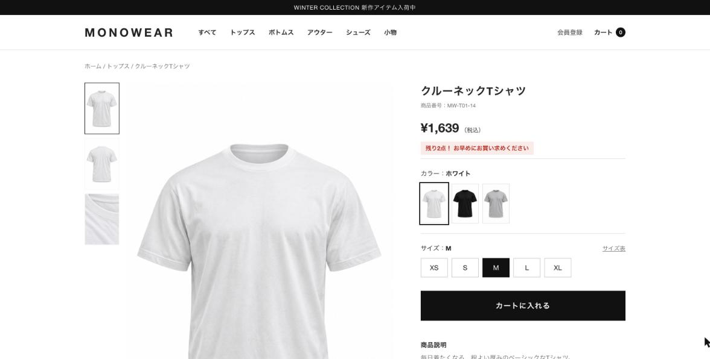

**何が起きるか**：「カートに入れる」を押しても、ヘッダーの「カート 0」が変わらない。リロードして初めて件数が増える。

**なぜ悪いか**：ユーザーは、操作の結果を画面の変化で確かめます。件数が変わらないと「入らなかった」と判断して、もう一度押してしまいます。#9（押しても反応がない）と組み合わさって、気づけば同じ商品が 3 個カートに入っている、という事故が起きます。

**自分ならどうするか**：カートの状態を 1 か所（Context や状態管理ライブラリ）で持ち、ヘッダーもカート画面も同じ状態を購読する。localStorage は「保存先」であって「状態そのもの」ではない、と分けて考える。

**コード**：`src/components/Header.tsx`（`useState(() => cartCount())` で最初に一度読むだけ）

### #2 クーポンのモーダル（トップ）

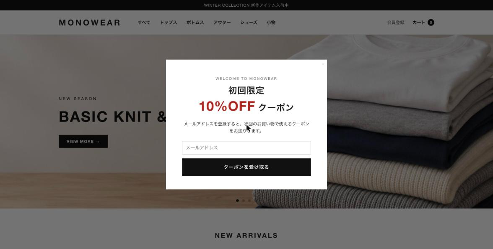

**何が起きるか**：トップを開くたびに、画面中央に「初回限定 10%OFF」のモーダルが出る。閉じる「×」は右上に小さく薄いグレーで、背景クリックや Esc キーでは閉じない。

**なぜ悪いか**：ユーザーが来た目的（商品を見る）より、ショップの都合（メールアドレスを集めたい）を優先しています。閉じ方が分かりにくいので「閉じられない＝クーポンを受け取るしかない」と感じさせます。一度閉じても、トップに戻るたびにまた出ます。

**自分ならどうするか**：出すとしても、一度閉じたら出さない。閉じるボタンは十分な大きさとコントラストにし、Esc と背景クリックでも閉じられるようにする。そもそもモーダルではなく、ページ内のバナーで足りないかを考える。

**コード**：`src/components/CouponModal.tsx`、`CouponModal.module.css` の `.close`

### #3 止められないカルーセル（トップ）

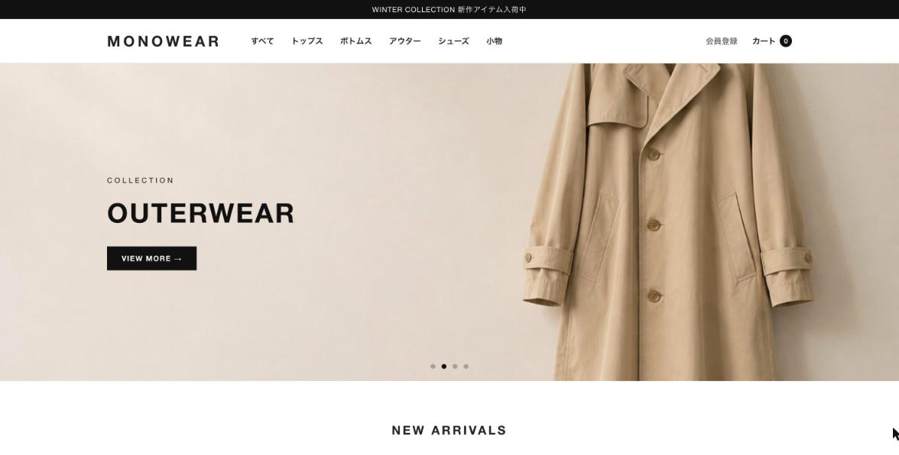

**何が起きるか**：メインビジュアルが 2.5 秒ごとに切り替わる。マウスを乗せても止まらず、前後のボタンもない。下のドットは押せそうに見えるが、ただの飾り。

**なぜ悪いか**：文字を読み終える前に切り替わります。押そうとした瞬間に別のスライドに変わり、意図しないページに飛ばされることもあります。動き続けるものは、読むのが遅い人や、動きに敏感な人にとって負担になります。

**自分ならどうするか**：自動再生するならホバーやフォーカスで止める。一時停止ボタンと前後ボタンを付ける。切り替え間隔は文字を読める長さにする。`prefers-reduced-motion` を尊重する。そもそもカルーセルが必要かを疑う。

**コード**：`src/components/HeroCarousel.tsx`

### #4 絞り込みがリセットされる（一覧）

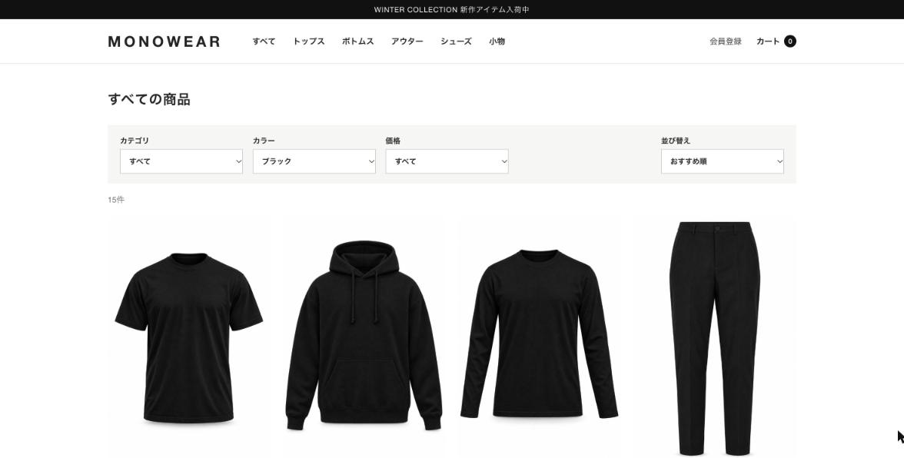

**何が起きるか**：カテゴリで「トップス」を選んだあとに、カラーで「ブラック」を選ぶと、カテゴリが「すべて」に戻る。価格や並び替えも同じ。

**なぜ悪いか**：「黒いトップスが見たい」という、ごく普通の探し方ができません。ユーザーは条件が消えたことに気づかず、「黒いトップスってこんなに少ないの？」と誤解することもあります。

**自分ならどうするか**：絞り込み条件はすべて URL のクエリに残し、1 つ変えるときは他の条件を保ったまま更新する。今かかっている条件を一覧で見せ、個別に外せるようにする。

**コード**：`src/pages/ProductList.tsx` の `update()`（`setParams({ [key]: value })` で他の条件を捨てている）

### #5 税抜と税込が混在（一覧 → 詳細）

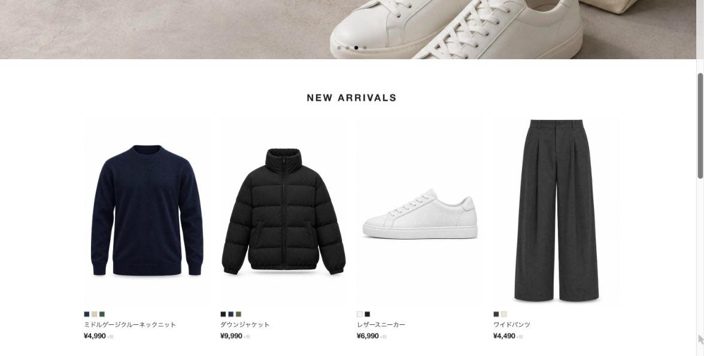


**何が起きるか**：一覧では「¥1,490 +税」（「+税」は小さく薄い）、詳細では「¥1,639（税込）」と表示される。

**なぜ悪いか**：一覧で見た金額と詳細の金額が違うので、「値上がりした？」「計算が合わない」と不信感を持たれます。一覧で予算内だと思って選んだ商品が、実際は予算を超えていることもあります。

**自分ならどうするか**：価格表示はサイト全体で税込に統一する（日本では総額表示が義務）。表示ルールを 1 つの関数・コンポーネントに集約し、画面ごとに書かない。

**コード**：`src/components/ProductCard.tsx`、`src/pages/ProductDetail.tsx`

### #6 在庫切れが一覧で分からない（一覧）

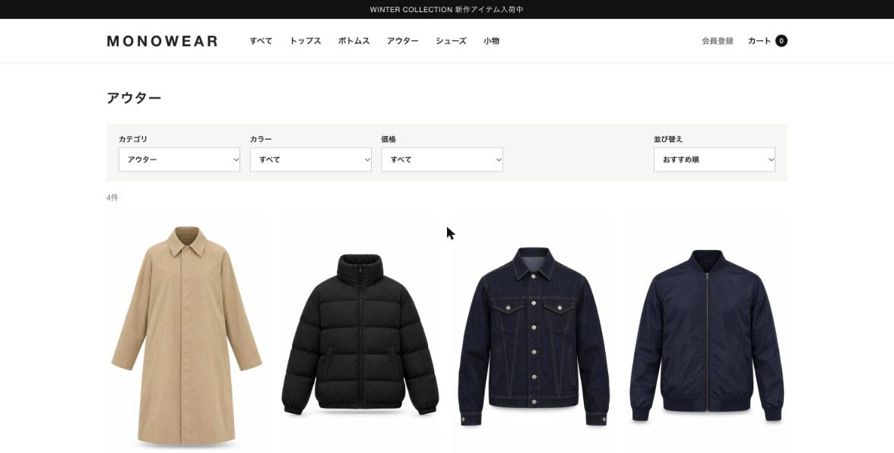
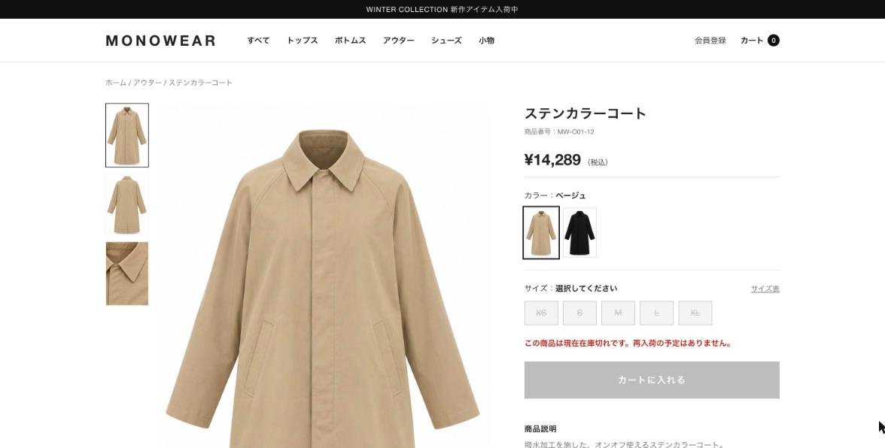

**何が起きるか**：全色・全サイズが在庫切れの「ストレートデニム」「ステンカラーコート」が、一覧では普通の商品と同じ見た目で並んでいる。新着にも出ている。詳細を開いて初めて在庫切れと分かる。

**なぜ悪いか**：ユーザーの「見て、選んで、開く」という手間が無駄になります。期待させてから落とすので、ただ「ない」より印象が悪くなります。

**自分ならどうするか**：一覧で「在庫切れ」「残りわずか」などを表示する。在庫切れを含めるかどうかを絞り込めるようにする。在庫切れ商品は並び順の後ろに回す。

**コード**：`src/components/ProductCard.tsx`、`src/data/products.ts` の `soldOut`

### #7 色を変えるとサイズがリセットされる（詳細）

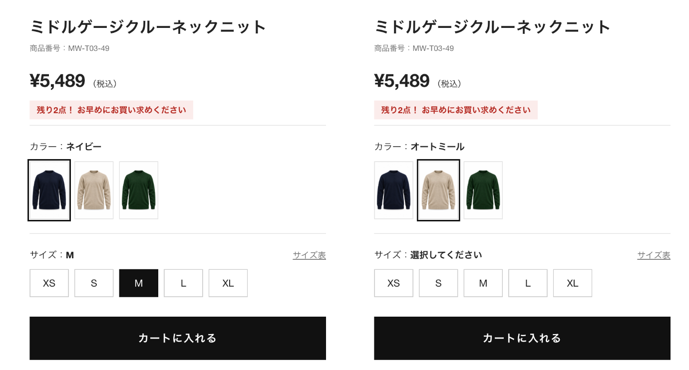

**何が起きるか**：サイズ「M」を選んでから色を変えると、サイズが「選択してください」に戻る。

**なぜ悪いか**：ユーザーにとって「自分のサイズ」は色に関係なく決まっています。色を見比べるたびにサイズを選び直させられます。リセットに気づかずに「カートに入れる」を押すと「サイズを選択してください」と言われます。

**自分ならどうするか**：色を変えてもサイズは保持する。新しい色でそのサイズが在庫切れのときだけ、その旨を伝える。

**コード**：`src/pages/ProductDetail.tsx` の `selectColor()`

### #8 サイズ表（詳細）

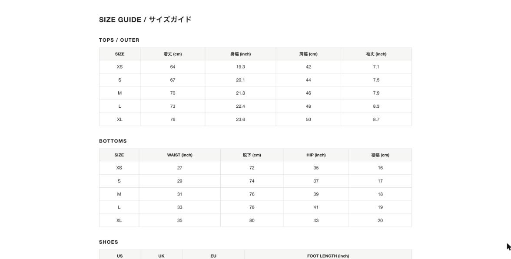

**何が起きるか**：「サイズ表」を押すと新しいタブで開く。表は列ごとに cm とインチが混在していて、靴は US サイズとインチしかない。詳細画面の「26.5」などの cm 表記とは対応づけられない。

**なぜ悪いか**：サイズ表は「どれを選べばいいか」を決めるための情報なのに、その場で見比べられず、単位の換算も必要です。タブが増えて、元のページに戻るのも手間です。

**自分ならどうするか**：サイズ表は詳細画面の中（モーダルや展開パネル）で見せる。単位はサイト全体で統一する。商品ごとの実寸を、選択肢のサイズと同じ表記で載せる。

**コード**：`src/pages/SizeChart.tsx`

### #9 「カートに入れる」の反応がない（詳細）


**何が起きるか**：押してもボタンの見た目は変わらず、メッセージも出ない。実際にはカートに追加されている。

**なぜ悪いか**：操作に反応がないと、ユーザーは「押せていない」と考えて何度も押します。#1 によってヘッダーの件数も変わらないので、確かめる手段もありません。結果として、意図しない数量がカートに入ります。

**自分ならどうするか**：押した直後にボタンの状態を変える（「追加しました ✓」など）。トーストやミニカートで、何がカートに入ったかを見せる。ヘッダーの件数を即座に更新する。

**コード**：`src/pages/ProductDetail.tsx` の `handleAdd()`

### #10 【ダーク】「残り2点！」（詳細）

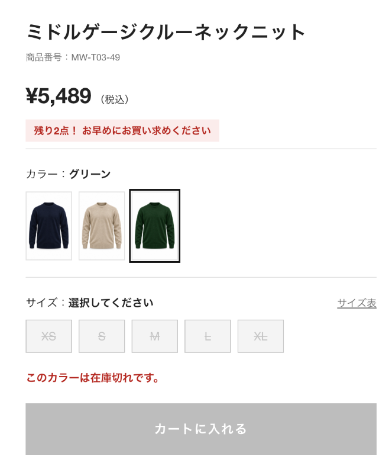

**何が起きるか**：どの商品にも「残り2点！ お早めにお買い求めください」と出る。在庫数とは関係なく、リロードしても変わらない。

**なぜ悪いか**：偽の希少性で焦らせ、冷静な判断をさせないためのダークパターンです。複数の商品を見ると嘘だと分かり、サイト全体への信頼を失います。表示内容によっては景品表示法（有利誤認）に触れるおそれもあります。

**自分ならどうするか**：在庫表示は実際の在庫数に基づかせる。「売上のために入れてほしい」と言われたら、短期の売上と長期の信頼のトレードオフを言葉にして議論する。

**コード**：`src/pages/ProductDetail.tsx`

### #11 数量を変えても反映されない（カート）

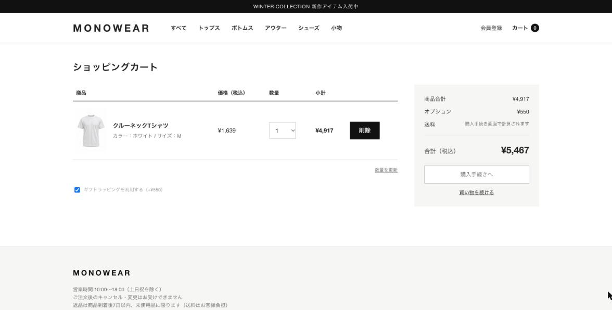

**何が起きるか**：数量のプルダウンを変えても、小計と合計が変わらない。右下の小さな「数量を更新」を押して初めて反映される。押さずに「購入手続きへ」進むと、変更は捨てられる。

**なぜ悪いか**：ユーザーは、選んだ時点で変更が終わったと考えます。金額が変わらないことに気づかないまま進むと、思った数量と違う注文になります。

**自分ならどうするか**：数量を変えたら即座に保存し、金額も更新する。「更新」ボタンが必要な設計なら、未保存の変更があることをはっきり示し、離脱時に警告する。

**コード**：`src/pages/Cart.tsx` の `draftQty`

### #12 「削除」が目立ち、即実行される（カート）


**何が起きるか**：各行の「削除」は黒い塗りのボタンで、画面の中で最も目立つ。押すと確認なしで消え、元に戻せない。一方、「購入手続きへ」は白地にグレー文字の地味なボタン。

**なぜ悪いか**：ボタンの目立ち方は「次にやるべきこと」を伝えるシグナルです。ここでは、ユーザーの目的（購入）より、取り返しのつかない操作（削除）を強調してしまっています。誤って押すと、商品を探し直すところからやり直しです。

**自分ならどうするか**：主要な行動（購入手続きへ）を最も目立たせる。削除はテキストリンク程度にし、消したあとに「元に戻す」を出す。

**コード**：`src/pages/Cart.tsx`、`Cart.module.css` の `.remove` / `.checkout`

### #13 【ダーク】ギフトラッピングが最初から追加されている（カート）

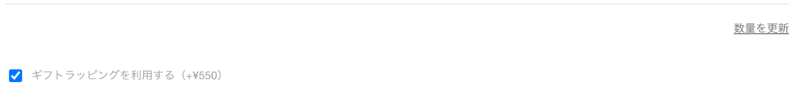

**何が起きるか**：カートの下に、小さな薄いグレーの文字で「ギフトラッピングを利用する（+¥550）」があり、最初からチェックが入っている。合計欄では「オプション ¥550」としか書かれていない。

**なぜ悪いか**：ユーザーが選んでいない有料オプションを、気づかれないように追加する「スニーク・イントゥ・バスケット」と呼ばれるダークパターンです。気づいたユーザーは「だまされた」と感じます。

**自分ならどうするか**：有料オプションは初期状態で OFF にする。合計欄には項目名をそのまま書く。

**コード**：`src/lib/cart.ts` の `getGiftWrap()`、`src/pages/Cart.tsx`

### #14 送料が最後まで分からない（カート → 購入手続き）


**何が起きるか**：カートでは送料が「購入手続き画面で計算されます」としか書かれていない。会員登録を終え、購入手続き画面に来て初めて「送料 ¥800」と分かる（税込 15,000 円以上なら無料だが、その条件もどこにも書かれていない）。

**なぜ悪いか**：最後に予想外の費用が出てくることは、EC でカゴ落ち（購入をやめること）の大きな原因です。会員登録までさせたあとに出すと、ユーザーの手間も無駄になります。

**自分ならどうするか**：カートの時点で送料を表示する。送料無料まであといくらかを示す。

**コード**：`src/pages/Cart.tsx`、`src/pages/Checkout.tsx`

### #15 【ダーク】「登録せずに購入」が見つからない（会員登録）

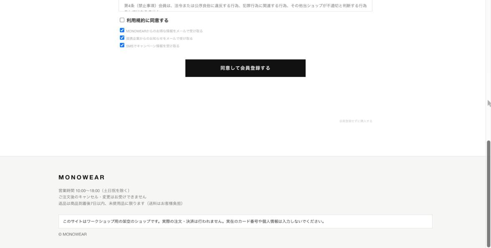

**何が起きるか**：「ご購入には会員登録が必要です」と書かれている。実際にはゲスト購入ができるが、そのリンクはページの最下部、右端に 9px の薄いグレー文字で置かれている。

**なぜ悪いか**：会員登録の強制は、カゴ落ちの代表的な原因です。抜け道を用意しつつ見つけにくくするのは、登録数を稼ぐためにユーザーを誘導するダークパターンです。

**自分ならどうするか**：ゲスト購入と会員登録を、同じ重みの選択肢として並べる。登録のメリット（次回から入力不要、など）を示して、ユーザーに選んでもらう。購入完了後に「この情報で会員登録しますか？」と聞く方法もある。

**コード**：`src/pages/Register.tsx`、`Register.module.css` の `.guest`

### #16 パスワードの条件が後出しで、入力が全部消える（会員登録）

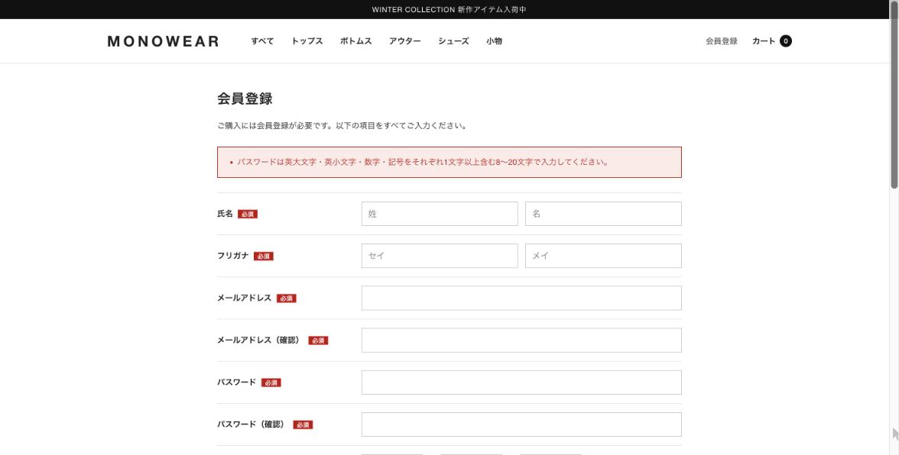

**何が起きるか**：パスワードの条件（英大文字・英小文字・数字・記号を含む 8〜20 文字）は、送信してエラーになるまでどこにも書かれていない。エラーになると、氏名やメールアドレスも含めて入力がすべて消える。

**なぜ悪いか**：条件を知らないまま入力させて失敗させ、さらに全部やり直させています。2 回目で諦めるユーザーも出ます。

**自分ならどうするか**：条件は入力欄のそばに最初から書く。入力中に条件を満たしたかをリアルタイムで示す。エラー時も、入力済みの内容は保持する（パスワード欄以外）。

**コード**：`src/pages/Register.tsx` の `formKey`（エラーのたびにフォームを作り直している）

### #17 【ダーク】メルマガが最初から全部 ON（会員登録）


**何が起きるか**：利用規約の同意チェックの下に、10px の薄い文字で「お得な情報」「提携企業からのお知らせ」「SMS」の 3 つの受信設定があり、最初からすべてチェックされている。

**なぜ悪いか**：ユーザーが望んでいない同意を、デフォルトで取ってしまうダークパターンです。特に「提携企業」への提供は、個人情報の扱いとして問題になります。

**自分ならどうするか**：任意の同意は初期状態で OFF にする（オプトイン）。必須の同意と任意の同意を、見た目でもはっきり分ける。

**コード**：`src/pages/Register.tsx`

### #18 全角・半角の指定がバラバラ（購入手続き）

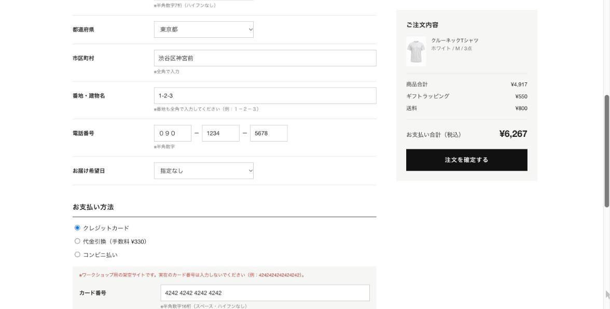

**何が起きるか**：氏名は「全角」、郵便番号は「半角数字 7 桁・ハイフンなし」、番地は「全角（例：１－２－３）」、電話番号は「半角」で 3 つの欄に分割されている。自動変換はしない。

**なぜ悪いか**：全角か半角かは、ユーザーにとってどうでもいい区別です。それをユーザーに合わせさせています。郵便番号から住所を補完することもしていません。

**自分ならどうするか**：入力された値をシステム側で正規化する（全角数字→半角、ハイフンの除去など）。郵便番号から住所を自動入力する。電話番号は 1 つの欄にする。`autocomplete` 属性を付けて、ブラウザの自動入力を効かせる。

**コード**：`src/pages/Checkout.tsx`

### #19 どの欄のエラーか分からない（購入手続き）

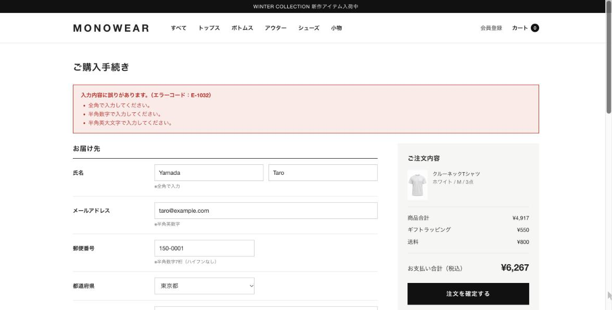

**何が起きるか**：「注文を確定する」を押すと、ページ上部に「入力内容に誤りがあります。（エラーコード：E-1032）」と「全角で入力してください。」のような文言だけが出る。どの欄の話なのかは書かれておらず、欄も強調されない。

**なぜ悪いか**：ユーザーは全部の欄を見直して、原因を推理しなければなりません。エラーコードはユーザーには意味がありません。

**自分ならどうするか**：エラーは該当する欄のすぐそばに出し、欄も強調する。最初のエラー欄にフォーカスを移す。入力中や欄を離れたときに検証して、送信前に気づけるようにする。

**コード**：`src/pages/Checkout.tsx` の `submit()`

### #20 完了画面に何もない（完了）

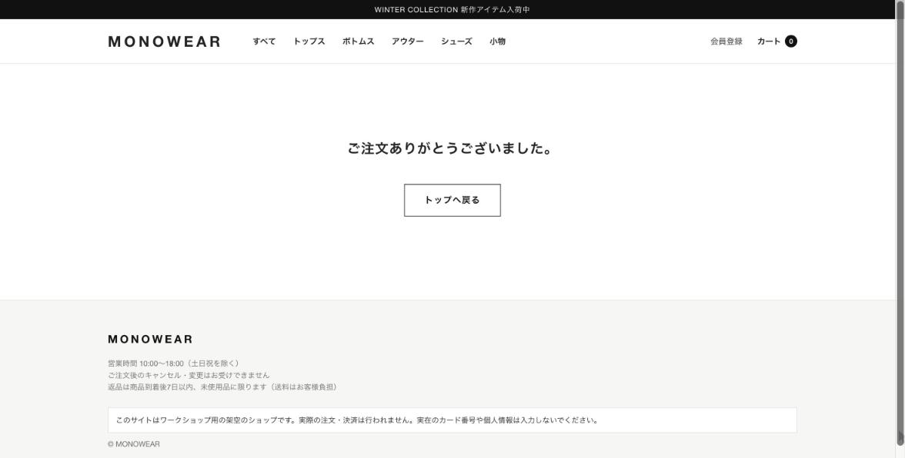

**何が起きるか**：「ご注文ありがとうございました。」と「トップへ戻る」だけ。注文番号も、何をいくらで買ったのかも、いつ届くのかも分からない。

**なぜ悪いか**：お金を払った直後のユーザーは「本当に注文できたか」「何が届くのか」を確かめたいはずです。問い合わせのときに伝える注文番号もありません。確認メールも届かない（という設定の）ので、不安だけが残ります。

**自分ならどうするか**：注文番号、注文内容、支払い金額、お届け予定日、確認メールの送信先を表示する。問い合わせ先も載せる。

**コード**：`src/pages/Complete.tsx`

---

## 開発

```bash
nvm use            # Node 22（.nvmrc）
npm install
npm run dev        # http://localhost:5173
npm run build      # 型チェック + ビルド
npm run lint
npm run deploy     # ビルドして Cloudflare Workers（静的アセット）にデプロイ
```

- 構成：Vite + React + TypeScript + React Router + CSS Modules
- 状態は localStorage（`monowear.cart`、`monowear.giftWrap`、`monowear.member`）に保存しています。
- **最初の状態に戻すには `/reset` を開いてください**（例：https://monowear.na2kera.workers.dev/reset ）。カート・会員情報などを消してトップに戻ります。リハーサル後や、参加者が端末を使い回すときに使います。参加者向けの導線はありません。
- 商品データは `src/data/products.ts` にまとまっています。

### 商品画像の生成

商品画像とトップのメインビジュアルは、Codex CLI の画像生成機能で作りました。

```bash
npm run images                       # 未生成の画像だけを生成して public/images に配置
npm run images -- --only t01,kv      # 一部だけ
npm run images -- --convert-only     # 生成済みの PNG を JPEG に変換し直すだけ
```

- 生成した元の PNG は `.raw-images/`（git 管理外）に保存し、`sips` で長辺 1200px の JPEG に縮小して `public/images/` に置いています。
- プロンプトは `scripts/generate-images.ts` にあります。
